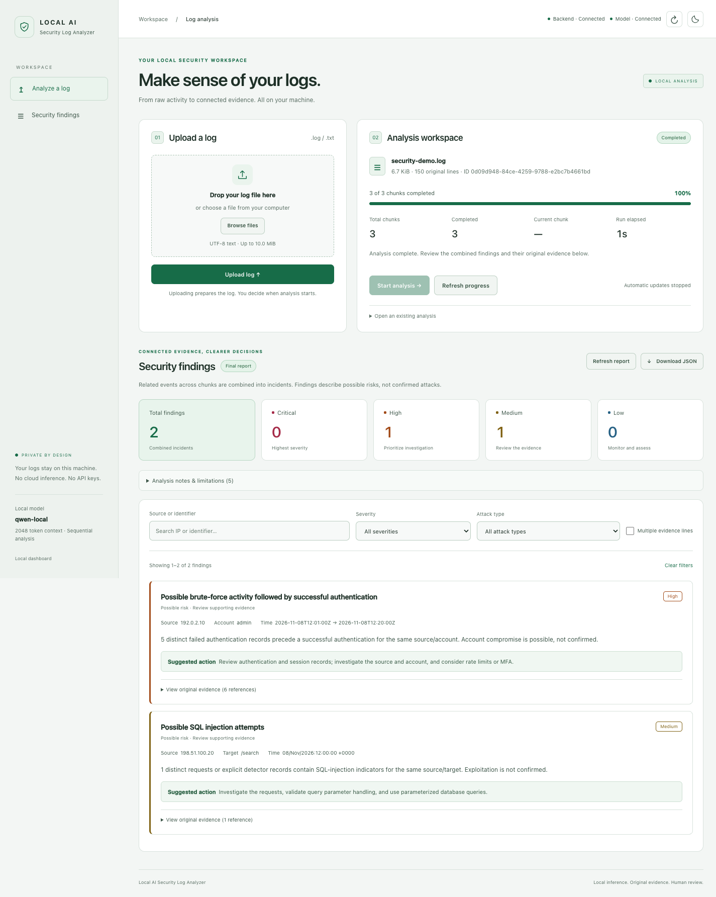
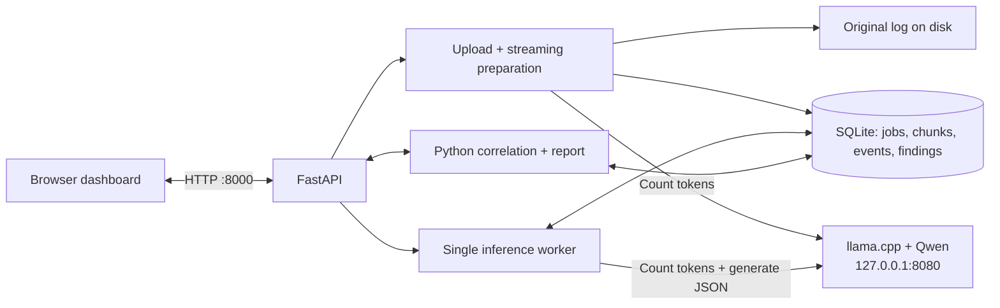
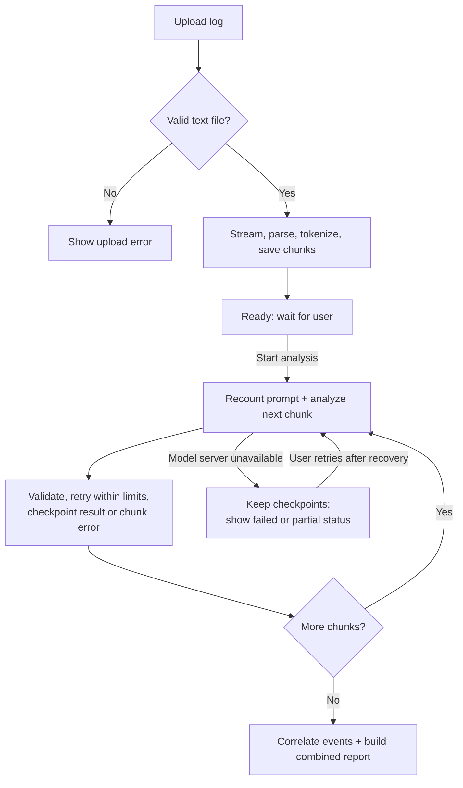
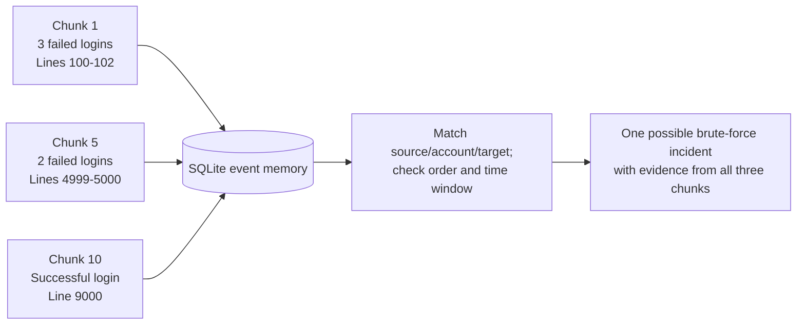

# Local AI Security Log Analyzer

Upload a server log, analyze it locally, and review suspicious activity with its
original evidence. Related events across distant chunks are combined into one
security report.

**Stack:** Python 3.11+ · FastAPI · SQLite · Jinja2 · Vanilla JavaScript · Qwen3.5 0.8B through llama.cpp

## Dashboard



*Actual dashboard with synthetic demo logs and a mocked local model. No production
log data is shown. Use the sun/moon button to switch themes; your choice is saved.*

## Features at a glance

| Feature | What it does |
| --- | --- |
| File upload | Browse or drop a UTF-8 `.log` or `.txt` file. Reject empty, binary, unsupported, or oversized uploads; the default limit is 10 MiB. |
| Local AI | Analyze through your separately started llama.cpp server. Application inference stays on loopback and needs no cloud API key. |
| Safe chunking | Read the log in small batches and measure complete prompts with the real model tokenizer. Keep original line numbers and long-entry fragments. |
| Persistent memory | Save events, chunks, findings, and checkpoints in SQLite so earlier evidence remains available. |
| Cross-chunk detection | Connect related authentication, SQL injection, scanning, denied-access, and request-rate observations across the file. |
| Evidence checks | Validate model JSON, cited lines, excerpts, and identifiers before accepting findings. |
| Reliable processing | Run one inference at a time, retry within limits, and preserve completed work after failures. |
| Report dashboard | Track progress, filter by severity/type/identifier, expand evidence, and download the complete JSON report. |

Findings describe **possible security risks**. A generic 404/500 or a successful
login alone does not establish an attack or account compromise.

## System diagram



FastAPI serves the dashboard and APIs. SQLite stores durable state. The model
runs as a separate local process; FastAPI does not launch or download it.

## How it works

1. **Upload:** Validate and stream the file to a UUID-based path on disk.
2. **Prepare:** Read entries sequentially, preserve original lines, count tokens,
   save safe chunks, and index relevant events. `ready` means prepared.
3. **Start:** The user explicitly starts analysis. One worker processes chunks in order.
4. **Validate and save:** Check model responses against source evidence and
   checkpoint each result. Failures keep completed work available.
5. **Correlate:** Group related events across the full file and merge supported AI
   assessments into combined incidents.
6. **Review:** Show severity counts, evidence, actions, errors, and limitations.
   Filters affect the display; JSON export contains the full report.



Preparation needs the local tokenizer. Uploading never starts AI inference
by itself. After a partial AI run, **Retry unfinished chunks** resumes saved work;
a preparation failure requires fixing the cause and uploading again.

### How distant chunks become one incident

Example: the same source `192.168.1.5` and account `admin` appear in three chunks.



With the default rule, five failures within 30 minutes followed by a matching
successful authentication can indicate brute-force activity and possible
compromise. Different sources, accounts, targets, and separate activity windows
remain separate. Missing timestamps use line order cautiously, with that
limitation disclosed. Duplicate records do not inflate event counts, and every
original reference is retained.

### How the token budget stays safe

```text
2048 total context - 384 reserved output - 64 safety = 1600 maximum input tokens

actual_input_tokens + 384 + 64 <= 2048
```

The input count includes the system prompt, compact prior context, evidence,
labels, and chat-template overhead. It is measured through llama.cpp before every
model call. If needed, the app removes compact context or splits entries further;
it does not silently discard source content. SQLite remains the full event memory.

## Run locally

Use **one backend worker** and the existing UV environment. Do not recreate it.
The environment used for this checkout is:

```sh
export UV_PROJECT_ENVIRONMENT="/Users/sakibsmacbookm5/Documents/Python work/.venv"
```

On another machine, point that variable to your existing environment. Project
dependencies must already be installed for offline commands. For installation
into that environment, use `uv run --locked python -c 'import app.main'` once;
this may need internet access. Keep `pyproject.toml` and `uv.lock` together.

### 1. Start your existing model

Use your installed llama.cpp and existing GGUF file; replace the model path:

```sh
llama-server \
  --model "/absolute/path/to/your/existing-model.gguf" \
  --alias qwen-local --host 127.0.0.1 --port 8080 \
  --ctx-size 2048 --threads 2 --threads-batch 2 \
  --n-gpu-layers 0 --parallel 1 \
  --batch-size 128 --ubatch-size 128 --jinja
```

### 2. Start FastAPI

From the project directory:

```sh
uv run --offline --no-sync uvicorn app.main:app \
  --host 127.0.0.1 --port 8000 --workers 1 --no-access-log
```

Open **http://127.0.0.1:8000**. Backend and frontend use the same server.
SQLite initializes automatically and existing supported databases migrate on startup.

Defaults work without `.env`. Keep any existing `.env`; for a fresh configuration,
copy `.env.example` to `.env` and add `--env-file .env` after `uv run` in the command
above. Important settings include `MODEL_BASE_URL`, `MODEL_ALIAS`,
`MAX_UPLOAD_BYTES`, `AUTH_FAILURE_THRESHOLD`, and `AUTH_WINDOW_SECONDS`.

### 3. Use the dashboard

**Upload log → Ready to analyze → Start analysis → Review evidence → Download JSON.**

Status updates every two seconds during active work and stops on terminal states.
The page shows model connection, total/completed/current chunks, percentage, and
elapsed run time. Reloading restores the current analysis without starting it again.
You can also open an existing UUID through the dashboard or `/?analysis=YOUR_UUID`.

Filters support severity, attack type, source/identifier search, and incidents
with multiple original evidence lines. Empty reports use neutral wording and
include coverage limitations.

## Main API endpoints

| Endpoint | Purpose |
| --- | --- |
| `GET /` | Dashboard |
| `GET /health` | Backend and SQLite health |
| `GET /api/model/health` | Local llama.cpp readiness |
| `POST /api/analyses` | Upload multipart `file`; return an analysis UUID |
| `GET /api/analyses/{id}` | Status, progress, timestamps, and errors |
| `POST /api/analyses/{id}/start` | Start or resume prepared analysis |
| `GET /api/analyses/{id}/report` | Combined incidents and original evidence |
| `GET /api/analyses/{id}/report?download=true` | Download the complete JSON report |

Paginated chunk, raw finding, and attempt-diagnostic endpoints are described in the
[technical reference](docs/technical-reference.md#routes-and-responses).
The complete API schema is available at `/openapi.json`.

## Tests

With `UV_PROJECT_ENVIRONMENT` pointing to the existing environment:

```sh
# Fast tests: temporary SQLite, fake tokenizer, mocked model
uv run --offline --no-sync pytest -q

# Real browser flows using installed Chrome and a mocked model
RUN_BROWSER_TESTS=1 uv run --offline --no-sync pytest -q tests/test_dashboard_browser.py
```

Coverage includes upload validation, original-line preservation, token limits,
JSON/evidence checks, retries, checkpoints, cross-chunk correlation, deduplication,
partial failures, dashboard filters, and exports. Tests use synthetic fixtures;
application findings are derived from uploaded evidence.

Optional checks against your running local model/tokenizer and screenshot capture
instructions are in the [testing reference](docs/technical-reference.md#tests).
No test automatically downloads a model or browser.

## Project layout

```text
app/
  main.py, config.py                 # App lifecycle and settings
  database.py, inference_database.py # Jobs, chunks, checkpoints and raw findings
  event_database.py                 # Persistent event memory
  routes/                           # Upload, status, model health and report APIs
  services/                         # Parsing, chunking, inference and correlation
  templates/ and static/            # Dashboard, light/dark themes and safe rendering
tests/                              # Unit, API, browser and optional model checks
docs/                               # Screenshot and detailed technical reference
AI_USAGE.md                         # AI usage and engineering decisions
```

## Limits and engineering choices

- Target hardware is **4 GB total RAM, two CPU threads, no GPU**. Combined model
  and app memory under load still needs benchmarking.
- Supports UTF-8 text. Unsupported formats and long fragmented records can hide
  fields; original uploaded evidence is retained.
- Runs as one backend process. SQLite and disk provide durable state; no Redis,
  Celery, Docker, Node, or frontend build server is needed.
- Logs and model output are untrusted. Evidence is checked and rendered as text;
  commands or markup from logs are never executed.
- A small model and configurable rules can miss attacks or flag legitimate
  behavior. Findings require human review; an empty report does not prove security.
- Completed uploads and database records remain on disk until manually managed;
  there is no retention/deletion interface yet.

See the [technical reference](docs/technical-reference.md) for complete settings,
API examples, severity rules, recovery details, and token-packing behavior.
[AI_USAGE.md](AI_USAGE.md) describes AI assistance and the engineering approach.
